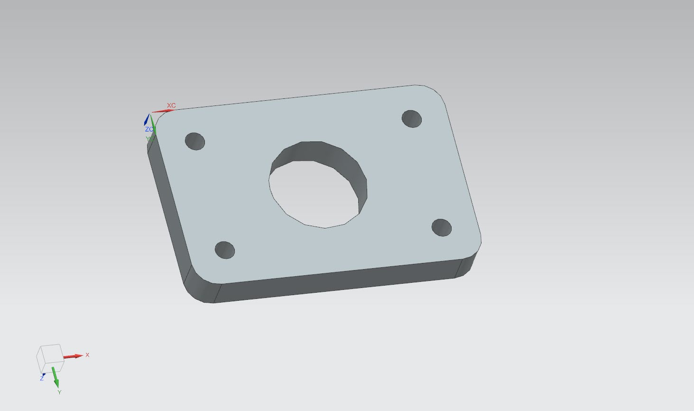
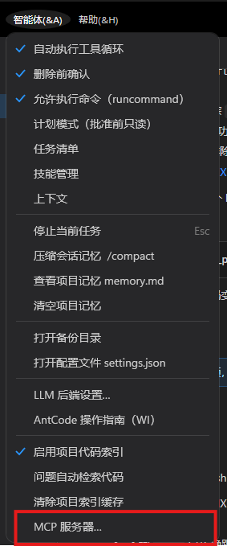
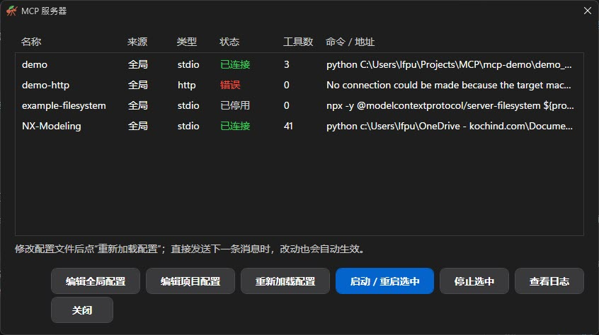

# MCP-NX-Modeling



```text
LLM / Claude Code / AntCode  ->  MCP Server (Python)  ->  NX Adapter  ->  Siemens NX
```

## 本项目兼容Claude Code 和 AntCode（[lfpu/AntCoode](https://github.com/lfpu/AntCode)）

## 阶段路线

| 阶段 | 内容 | 状态 |
| --- | --- | --- |
| Phase 0 | NX API 技术验证（不含 MCP） | 已通过（NX 2412 / NX 内置 Python 3.11.9） |
| Phase 1 | 最小 MCP Server（status/new/open/save/block/cylinder/get_bodies/get_features） | 下一步 |
| Phase 2 | 观察能力（bodies/faces/edges/object info） | 待做 |
| Phase 3 | 草图与基础特征（sketch/extrude/revolve/hole） | 待做 |
| Phase 4 | Boolean、倒角/圆角、阵列、基准 | 待做 |
| Phase 5 | 几何选择系统（find_faces/find_edges） | 待做 |
| Phase 6 | 安全机制（读/改/危险三级、Undo Mark） | 待做 |
| Phase 7 | 装配与工程图 | 待做 |

## Phase 0：NX API 技术验证

目标：确认当前 NX 版本下，Python 能稳定完成下面这条链路：

```text
连接 NX Session -> 新建 Part(mm) -> 创建 100x60x20 Block -> 查询 Body/Face/Edge -> 保存 .prt -> 写出 result.json
```

### 文件

- `phase0/nx_phase0_verify.py`：真正调用 NXOpen 的脚本，必须在 NX 自带的 Python 环境里运行（普通 python 无法 import NXOpen）。
- `phase0/run_phase0.ps1`：用 NX 的 `run_journal.exe` 在无界面模式下执行上面的脚本，并解析结果。

### 运行

在装有 NX 且许可证可用的机器上，PowerShell 里执行：

```powershell
.\phase0\run_phase0.ps1
# 或手动指定 NX 的 NXBIN 目录
.\phase0\run_phase0.ps1 -NxBin 'C:\Program Files\Siemens\NX2306\NXBIN'
```

脚本会自动：

1. 查找 `run_journal.exe`（参数 -NxBin、环境变量 UGII_BASE_DIR、C:\Program Files\Siemens 下自动搜索）。
2. 设置输出目录环境变量 `NX_PHASE0_OUT`（默认 `phase0/output`）。
3. 执行验证脚本，读取 `result.json` 并打印每一步的状态。

也可以在 NX 界面里用 File > Execute > NX Open 直接运行 `phase0/nx_phase0_verify.py`，结果同样写到 `result.json`。

### 验收标准

| 步骤 | 通过条件 |
| --- | --- |
| connect_session | 能获取 NX Session，记录 UGII_BASE_DIR 等信息 |
| new_part | 创建毫米单位的新 Part |
| create_block | 创建 100x60x20 Block（带 Undo Mark，失败自动回滚） |
| query_model | 1 个 Body、6 个 Face、12 条 Edge |
| measure_volume（可选） | 体积约 120000 mm^3 |
| save_part | 生成 `phase0_block.prt` 且文件大小大于 0 |
| reopen_part（可选） | 关闭后重新打开，仍有 1 个 Body |

全部必选步骤通过（`success=true`）即 Phase 0 完成，之后进入 Phase 1（把这些能力封装为 NX Adapter + MCP Tool）。

### 常见问题

- 提示找不到 run_journal.exe：用 `-NxBin` 指定，或设置 `UGII_BASE_DIR`。
- 没有生成 result.json：多为许可证问题，确认 `UGS_LICENSE_SERVER` 已配置且 NX 能正常启动。
- NewDisplay 失败：确认输出路径可写，且同名 .prt 没有被其它 NX 进程占用。

## 设计原则（后续阶段沿用）

- `nx/` 只负责调用 NX，`tools/` 只负责 MCP，二者分离。
- Tool 返回结构化结果（feature id、body id），不要只返回 success。
- 大量几何数据在 Python 侧筛选后再返回给 LLM，节省 token。

## 完整架构（Phase 1~7 已实现，待在 NX 中逐项验证）

```text
MCP 客户端 --stdio--> main.py (nx_mcp, 系统 Python + mcp SDK)
                          --TCP 127.0.0.1:8765--> nx_worker (NX 内置 Python 3.11, 仅标准库 + NXOpen)
```

- `nx_mcp/`：MCP 层。`tools/*.py` 每个文件一组 Tool，`client.py` 负责 TCP 通信并在需要时用 run_journal.exe 自动拉起 worker。
- `nx_worker/`：NX 层。`handlers/*.py` 用 `@command` 注册命令，`dispatch.py` 提供安全层。
- 对象 id：`FACE_123` / `EDGE_45` / `BODY_7` / `FEATURE_9` / `SKETCH_3`，来自 NX 的 tag，只在当前会话有效。

### 安全分级

| 级别 | 行为 |
| --- | --- |
| read | 只查询 |
| session | 新建/打开/保存/关闭 Part |
| modify | 包在 Undo Mark 里，失败自动回滚；成功后记入历史，可用 nx_undo_last 撤销（最近 20 步） |
| dangerous | 必须 confirm=true（nx_delete_object、nx_close_part_discard） |

### Tool 列表

- Part：nx_get_status / nx_new_part / nx_open_part / nx_save_part / nx_save_part_as / nx_close_part / nx_close_part_discard / nx_undo_last / nx_undo_history
- 体素：nx_create_block / nx_create_cylinder / nx_create_cone / nx_create_sphere
- 观察：nx_get_part_info / nx_get_bodies / nx_get_features / nx_get_expressions / nx_get_object_info / nx_get_selected_objects
- 选择：nx_find_faces / nx_find_edges / nx_get_faces / nx_get_edges / nx_face_neighbors
- 草图：nx_create_sketch / nx_add_to_sketch / nx_get_sketches
- 特征：nx_extrude / nx_pocket / nx_revolve / nx_create_hole / nx_boolean / nx_edge_blend / nx_chamfer / nx_create_datum_plane / nx_edit_expression / nx_delete_object
- 辅助：nx_pattern_points（生成孔阵列坐标）
- 装配：nx_add_component / nx_get_components / nx_move_component

### 运行

```powershell
pip install -r requirements.txt
# 1) 不依赖 MCP SDK 的端到端冒烟测试（底板 + 圆角 + 5 个孔）
python examples/smoke_test.py
# 2) 作为 MCP 服务使用：参考 .mcp.json.example 配置到 Claude Code / Copilot
python main.py
```

环境变量：NX_MCP_NXBIN（NXBIN 目录）、NX_MCP_PORT（默认 8765）、NX_MCP_TOKEN、NX_MCP_AUTOSTART（0 为不自动拉起）。日志在 `logs/`。

### 已知限制（诚实说明）

- 基础和高阶功能的冒烟测试已在 NX 2412 通过（见上方“高阶功能”表），但未测试的项（装配的同心/距离/平行/垂直/角度约束、圆形与网格阵列、STEP 导入、倒斜角、旋转等）仍可能需要按报错微调。
- 孔是布尔减去圆柱/圆锥实现，不是 NX Hole 特征；草图没有几何约束和尺寸标注（按精确坐标绘制）。

## 面向使用者：AntCode / Claude Code 使用教程

本项目是一个 MCP Server。完成 MCP 配置后，日常使用时不需要手工调用 `nx_*` Tool，也不需要自己编写 NXOpen Python 脚本。直接用自然语言告诉 AntCode、Claude Code 等 MCP 客户端你希望在 Siemens NX 中完成什么操作，LLM 会根据任务选择合适的 Tool。

### 1. 准备环境

推荐环境：

- Siemens NX 2412
- NX 内置 Python 3.11
- 系统 Python 3.12
- MCP Python SDK（当前项目开发环境为 2.3.0）

先安装 Python 依赖：

```powershell
pip install -r requirements.txt
```

正常情况下不需要手工启动 NX Worker。MCP Server 第一次调用 NX Tool 时会通过 `run_journal.exe` 自动拉起常驻 Worker。

如果自动查找不到 NX，可以设置：

```powershell
$env:NX_MCP_NXBIN = 'C:\Program Files\Siemens\NX2412\NXBIN'
```

实际 NX 安装目录以本机为准。

### 2. 配置 MCP 客户端

仓库根目录提供了 `.mcp.json.example`，可作为 MCP 客户端配置模板。核心目标是让客户端通过系统 Python 启动本项目根目录下的 `main.py`。

建议同时设置 `NX_MCP_WORKSPACE` 为实际建模项目的工作目录。这样可以直接让 AI 使用相对路径，例如 `output/base.prt`，而不需要在对话里反复输入完整 Windows 路径。

路径解析规则为：

```text
绝对路径 > 当前 nx_set_workspace 设置的工作区 > NX_MCP_WORKSPACE
```

如果没有可用工作区，相对路径会被拒绝，不会偷偷回退到 MCP Server 自身的 cwd。

#### AntCode

在 AntCode 的 MCP Servers 中导入或添加本项目配置，启动/连接服务后确认能够看到 `NX-Modeling` 提供的 `nx_*` 工具。


之后可以直接在 Chat 中输入自然语言任务，不需要自己写 Tool JSON。例如：

```text
检查一下 NX 当前是否已经连接，并告诉我当前打开的是哪个 Part。
```

如果连接正常，AntCode 会调用类似 `nx_get_status` 的 MCP Tool，并把结果返回给模型。

#### Claude Code

把 `.mcp.json.example` 中对应配置加入 Claude Code 使用的 MCP 配置，并把命令、项目路径和环境变量改成当前机器实际值。

连接成功后，同样可以直接使用自然语言，例如：

```text
使用 NX MCP 在当前工作区创建一个 100 x 60 x 20 mm 的底板并保存。
```

具体 MCP 配置文件位置和导入方式可能随客户端版本变化，请以所使用客户端当前版本的 MCP 配置方式为准。

### 3. 建议先设置工作区

如果客户端没有通过环境变量提供 `NX_MCP_WORKSPACE`，可以先告诉 AI：

```text
把 NX 工作区设置为 D:\Projects\MyNXProject，然后后面的文件都使用相对路径。
```

LLM 可以通过 `nx_set_workspace` 设置工作区。之后可以直接说：

```text
新建 output/base.prt。
```

而不用反复提供完整路径。

### 4. 日常使用方式

最推荐的方式是描述“最终想得到什么”，让 LLM 自己拆解步骤。例如：

```text
帮我创建一个 100 x 60 x 20 mm 的底板，在四角各打一个直径 6 mm 的通孔，外边缘做 R3 圆角，然后保存。
```

也可以一步一步控制：

```text
新建一个零件 output/base.prt，单位 mm。
```

```text
创建一个从原点开始、尺寸 100 x 60 x 20 mm 的长方体。
```

```text
找出这个长方体最上面的平面。
```

```text
在距离四个角各 10 mm 的位置打直径 6 mm 的通孔。
```

```text
查询外轮廓边，然后做 R3 圆角。
```

```text
保存当前 Part，并告诉我最终文件路径。
```

对于查询几何对象，建议让 AI 使用 `nx_find_faces`、`nx_find_edges` 等选择 Tool，而不是一次返回模型中的全部几何数据，这样可以显著减少上下文和 Token 消耗。

### 5. 一个完整 Demo：底板 + 通孔 + 圆角 + 工程图

下面是一个适合第一次验证 AntCode / Claude Code 与 NX MCP 完整链路的任务。

直接对 AI 输入：

```text
使用 NX MCP 完成下面的零件：

1. 在当前工作区创建 demo/base_plate.prt，单位 mm。
2. 创建一个 100 x 60 x 20 mm 的长方体底板。
3. 在顶面的四个角附近分别创建一个直径 6 mm 的通孔，孔中心距离相邻两条边都是 10 mm。
4. 对底板合适的外轮廓边做 R3 圆角。
5. 检查最后的 Body、包围盒和体积，确认操作确实成功。
6. 保存 Part。
7. 创建工程图，加入基本视图。
8. 把工程图导出到 demo/base_plate.pdf。
9. 最后告诉我创建了哪些文件，以及主要建模结果。

操作过程中优先使用几何选择 Tool 查找需要的面和边，不要把所有几何数据全部返回到上下文。
```

LLM 实际执行的 Tool 链路大致会是：

```text
用户自然语言
    |
    v
nx_get_status / nx_get_workspace
    |
    v
nx_new_part
    |
    v
nx_create_block
    |
    v
nx_find_faces
    |
    v
nx_create_hole
    |
    v
nx_find_edges
    |
    v
nx_edge_blend
    |
    v
nx_get_bodies / nx_mass_properties
    |
    v
nx_save_part
    |
    v
nx_create_drawing_sheet
    |
    v
nx_add_base_view
    |
    v
nx_export_drawing_pdf
```

具体调用顺序可能由 LLM 根据每一步返回的 NX 对象 ID 和几何结果动态调整。例如 `FACE_123`、`EDGE_45` 等 ID 来自当前 NX Session，因此不要把上一次 NX 会话里的对象 ID 保存下来并在新会话里继续使用。

预期最终至少得到：

```text
demo/
  base_plate.prt
  base_plate.pdf
```

可以继续追问：

```text
检查一下当前零件的尺寸、体积和孔的位置是否符合我的要求。
```

或者：

```text
把这个零件另存一个版本，再把四个孔从直径 6 mm 改成 8 mm。
```

### 6. 使用现有 Part

不一定每次都新建模型。例如：

```text
打开 parts/bracket.prt，告诉我当前模型的整体尺寸和特征树。
```

或者：

```text
打开 parts/bracket.prt，找到所有圆柱面，把半径和中心位置列出来。
```

LLM 通常会组合 `nx_open_part`、`nx_get_part_info`、`nx_get_features`、`nx_find_faces` 等 Tool 完成任务。

### 7. 修改、撤销与危险操作

普通建模修改会放在 NX Undo Mark 中。如果某次修改结果不满意，可以直接告诉 AI：

```text
撤销刚才的建模操作。
```

对应 `nx_undo_last`，历史最多保留最近 20 次本服务执行的成功建模操作。

删除对象以及放弃未保存修改关闭 Part 属于危险操作，例如：

- `nx_delete_object`
- `nx_close_part_discard`

这些 Tool 需要明确确认，并以 `confirm=true` 执行。建议在进行此类操作前先让 AI 查询目标对象，确认无误后再授权删除或放弃修改。

### 8. 装配示例

可以直接描述装配目标：

```text
新建一个装配，把 asm/base.prt 和 asm/plate.prt 加入装配。固定 base，然后查询两个组件可以用于贴合的平面，让 plate 的底面贴合到 base 的顶面，最后保存装配。
```

`fix`、`touch`、`concentric`、`distance`、`parallel`、`perpendicular` 和 `angle` 均已在 NX 2412 实机提交并保存成功。装配求解后仍建议让 AI 重新查询组件位置、相关面或距离，对最终几何状态做二次校验。

### 9. 出图和导出示例

例如：

```text
给当前零件创建一张 A4 工程图，添加基本视图和投影视图，然后导出为 output/drawing.pdf。
```

或者：

```text
把当前零件同时导出 STEP、IGES 和 STL 到 output 目录。
```

工程图创建及 PDF 导出、STEP/IGES/STL 导出已经在 NX 2412 实测。STEP 导入也已完成导出再导入回环测试，导入前后实体体积均为 `9216 mm³`。

### 10. 出错时怎么处理

如果 AI 调用 NX Tool 失败，优先检查：

1. Siemens NX 许可证是否可用。
2. `NX_MCP_NXBIN` 是否指向正确的 NX `NXBIN`。
3. MCP Server 是否已经连接。
4. `NX_MCP_WORKSPACE` 或 `nx_set_workspace` 设置的目录是否正确。
5. `logs/nx_worker.log` 和 `logs/run_journal.log` 中的真实 NXOpen 报错。

如果刚修改过 `nx_worker/` 源码，需要停止旧 Worker：

```powershell
python scripts/stop_worker.py
```

下一次 MCP 调用会重新加载新的 Worker 代码。

### 11. 推荐的提问方式

为了提高成功率，Prompt 最好明确给出：

- 单位，例如 mm。
- 关键尺寸，例如 `100 x 60 x 20`、`Ø6`、`R3`。
- 相对位置，例如“距 X/Y 两侧各 10 mm”。
- 输出文件，例如 `output/base.prt`。
- 是否需要保存、导出或生成工程图。
- 是否要求最后进行几何/尺寸验证。

例如：

```text
使用 NX MCP 创建 output/bracket.prt，单位 mm。底板尺寸 120 x 80 x 10 mm，在四角距边 12 mm 的位置做 4 个 Ø8 通孔。完成后检查包围盒、孔位置和体积，确认无误后保存 Part，并导出 STEP 到 output/bracket.stp。
```

这种方式比逐个指定 `nx_*` Tool 更适合作为日常操作方式，因为 LLM 可以根据 NX 返回的对象 ID、几何信息和错误动态决定下一步。
- 拔模、剖视图和工程图尺寸标注尚未实现；装配已支持并实测 `fix`、`touch`、`concentric`、`distance`、`parallel`、`perpendicular` 和 `angle`，但复杂多约束组合仍建议在求解后重新查询几何状态。
- worker 单线程串行处理请求，长时间操作期间其他请求会排队。

### 开发提示：改完 nx_worker 代码要重启 worker

NX 里的 worker 是常驻进程，已加载的模块不会自动刷新。修改 `nx_worker/` 下任何文件后，先执行 `python scripts/stop_worker.py`（`examples/smoke_test.py` 每次运行开头会自动做这一步），下一次调用会自动拉起新的 worker。

## 高阶功能（已在 NX 2412 实测）

除前面的基础 Tool 外，新增并经 `examples/smoke_advanced.py`（13 项）和 `examples/smoke_assembly.py` 验证：

| 类别 | Tool | 验证情况 |
| --- | --- | --- |
| 工作区 | nx_set_workspace / nx_get_workspace | 通过 |
| 草图在面上、拉伸、切除 | nx_create_sketch(face=...) / nx_extrude / nx_pocket | 通过，按体积校验 |
| 原生孔 | `nx_hole_native` | Simple Through、Simple Blind、Counterbored、Countersink 均生成原生 `HOLE PACKAGE`；支持失败时回退布尔减孔 |
| 草图约束与尺寸 | `nx_sketch_add_constraint` / `nx_sketch_add_dimension` | 水平、垂直、重合、水平长度、垂直长度、半径、直径已在 NX 2412 实测通过 |
| 抽壳 | nx_shell | 通过，按体积校验 |
| 特征阵列 | `nx_pattern_feature`（线性 / 网格 / 圆形） | 通过；3×2 网格阵列生成 6 个 Body，四实例 360° 圆形阵列生成 4 个 Body |
| 镜像 | nx_mirror_body | 通过，按尺寸校验 |
| 抑制、重命名、基准轴 | nx_suppress_feature / nx_rename_object / nx_create_datum_axis | 通过 |
| 测量 | nx_mass_properties / nx_measure_distance | 通过（面到面距离走 NX 精确测量） |
| 导入导出 | `nx_export_step` / `nx_export_iges` / `nx_export_stl` / `nx_import_step` | STEP / IGES / STL 导出通过；STEP 导入回环通过，导入前后体积均为 `9216 mm³` |
| 撤销与确认 | nx_undo_last / 危险操作 confirm | 通过 |
| 工程图 | nx_create_drawing_sheet / nx_add_base_view / nx_add_projected_view / nx_export_drawing_pdf | 通过，生成了 PDF |
| 装配约束 | `nx_component_faces` / `nx_add_constraint` | `fix`、`touch`、`concentric`、`distance`、`parallel`、`perpendicular`、`angle` 均已在 NX 2412 提交并保存成功 |

### 开发经验（NX 2412）

- 属性名不确定时，用 `scripts/probe_api*.py` 在 NX 里查真实属性，输出写到 `logs/`，再读文件，不要凭印象写。
- 选择类对象（如镜像的 `Plane`、投影视图的 `Parent.View`）本身只读，要设置它的 `.Value`。
- Builder 的 `Null` 要用对应类型（基本视图用 `Drawings.BaseView.Null`，投影视图用 `Drawings.ProjectedView.Null`）。
- 草图的平面参照必须是 Plane，不能直接传 Face；在面上建草图时用该面生成的基准平面（因此与面不关联）。


## NX 2412 最新实测状态

以下测试均由系统 Python 通过 TCP 调用常驻 NX Worker。修改 `nx_worker/` 后必须先执行 `python scripts/stop_worker.py`，避免继续运行旧代码。

| 测试脚本 | 覆盖内容 | 结果 |
| --- | --- | --- |
| `examples/smoke_test.py` | 底板、圆角、通孔、保存 | 通过 |
| `examples/smoke_advanced.py` | 抽壳、镜像、线性阵列、测量、导出、工程图等 | 13/13 通过 |
| `examples/smoke_assembly.py` | `fix + touch` 装配约束 | 通过，板件底面落到 `z=10.0000` |
| `examples/smoke_native.py` | 原生孔、草图约束与尺寸、网格阵列、圆形阵列 | 通过，日志结尾为 `ALL_NATIVE_SMOKE_TESTS_PASSED` |
| `scripts/test_remaining_features.py` | 倒斜角、旋转、STEP 导出导入回环 | 通过；旋转体积 `14074.3351 mm³`，STEP 导入前后体积 `9216 mm³` |
| `scripts/test_assembly_constraints.py` | `parallel`、`perpendicular`、`distance`、`angle`、`concentric` | 全部通过，日志结尾为 `ASSEMBLY_CONSTRAINT_TESTS_PASSED` |

### 原生孔 `nx_hole_native`

支持以下原生 NX `HOLE PACKAGE` 类型：

- `hole_form="simple"`：简单孔。
- `hole_form="counterbore"`：沉孔，需要 `cbore_diameter` 和 `cbore_depth`。
- `hole_form="countersink"`：锥形沉孔，需要 `csink_diameter`，可设置 `csink_angle`。
- `through=true` 创建贯穿孔，否则使用 `depth` 创建盲孔。
- `fallback=true` 时，原生接口失败会回退到已有布尔减孔实现；设置 `fallback=false` 可要求必须创建原生 Hole 特征。

已验证 D10 贯穿 20 mm 实体时移除体积为 `1570.7963 mm³`，与理论值一致。

### 草图约束与尺寸

`nx_sketch_add_constraint` 支持：

- `horizontal`
- `vertical`
- `fixed`
- `coincident`
- `tangent`
- `parallel`
- `perpendicular`
- `concentric`

`nx_sketch_add_dimension` 支持：

- `horizontal`
- `vertical`
- `parallel`
- `perpendicular`
- `angular`
- `radius`
- `diameter`

几何通过从 0 开始的 `geometry_index` 引用。端点关联可以使用 `start`、`end`、`mid`、`center`。角度输入使用度，内部创建弧度单位的 NX 系统表达式；其他尺寸使用毫米单位表达式。

注意：修改草图中的几何对象后，`Sketch.GetAllGeometry()` 的索引可能变化。继续添加约束或尺寸前，应重新确认几何顺序。

### STEP 导入实现

NX 2412 在 `run_journal` 批处理会话中，`Step214Importer` 的 `NewPart + OutputFile` 不保证直接保存目标文件。当前实现采用：

1. `ImportTo=NewPart`。
2. `FileOpenFlag=true`，让转换生成的新 Part 成为当前工作 Part。
3. `ProcessHoldFlag=true`，等待转换完成。
4. 导入后对当前工作 Part 执行 `SaveAs(output_part)`。

该路径已经通过 STEP 导出再导入回环和实体体积一致性验证。

### 当前已知限制

- 面上草图通过目标平面创建固定基准平面，暂不与原始面保持参数化关联。
- 拔模、剖视图和工程图尺寸标注尚未实现。
- 曲面包围盒主要通过边顶点估算，复杂自由曲面应结合 NX 精确测量结果判断。
- NX Tag 对象 ID 只在当前 NX 会话有效；重启 Worker 或重新打开 Part 后必须重新查询。
- Worker 单线程串行处理请求，长时间导入导出或复杂更新期间其他请求会排队。
- 装配约束虽已逐项实测通过，复杂多约束组合仍可能出现过约束、欠约束或不同求解分支，应在求解后重新查询组件位置、相关面及距离。

### 最终验证命令

```powershell
python scripts/stop_worker.py
python -m compileall nx_worker nx_mcp examples scripts
python scripts/check_registry.py
python examples/smoke_native.py
python scripts/test_remaining_features.py
python scripts/test_assembly_constraints.py
```
